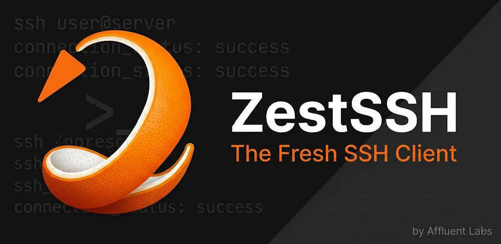
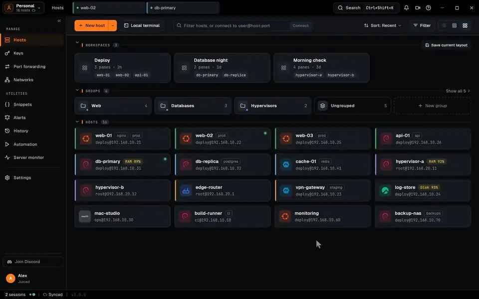
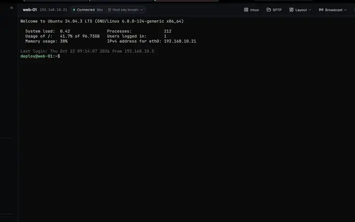
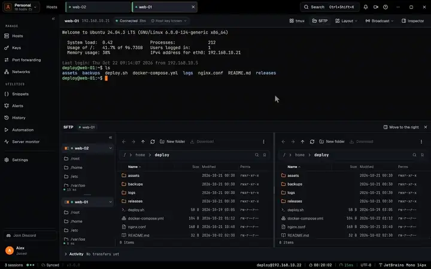
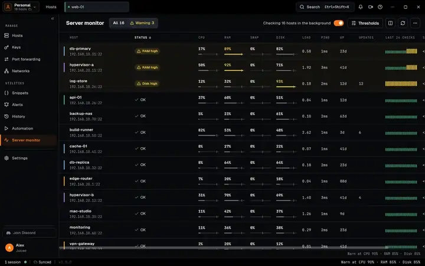
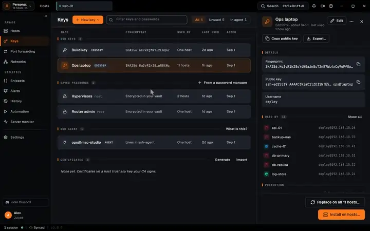
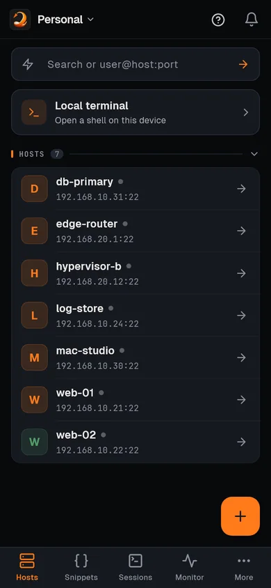

<p align="center">
  <a href="https://zestssh.com"></a>
</p>

<h1 align="center">Zest Core</h1>

<p align="center"><b>zest_ssh_core</b>, the pure-Dart SSH and SFTP engine inside <a href="https://zestssh.com">ZestSSH</a></p>

<p align="center">
  <a href="https://github.com/AffluentMods/zest_ssh_core/actions/workflows/test.yml"></a>
  <a href="https://www.bestpractices.dev/projects/16027"></a>
  <a href="https://scorecard.dev/viewer/?uri=github.com/AffluentMods/zest_ssh_core"></a>
  <a href="LICENSE"></a>
</p>

A pure-Dart SSH and SFTP library, forked from [dartssh2](https://github.com/vicajilau/dartssh2) and hardened for use in [ZestSSH](https://zestssh.com).

The reason it is public: the code that talks to your servers should be code you can read. This is the exact SSH stack ZestSSH ships, nothing stripped out for the open-source version. If you want to know how the client authenticates, what it negotiates, or how it handles a host key, it is all here.

MIT licensed, free to use, and staying that way.

## Powering ZestSSH

Every connection [ZestSSH](https://zestssh.com) makes, on Windows, macOS, Linux, Android and iOS, goes through this library: the terminal, SFTP, port forwarding, server monitoring and the keys you sign in with. (The hosts in these clips are made-up demo data.)

<p align="center">
  <a href="https://zestssh.com"></a>
</p>

<table>
  <tr>
    <td align="center" width="50%"><br><b>Terminal</b></td>
    <td align="center" width="50%"><br><b>SFTP</b></td>
  </tr>
  <tr>
    <td align="center"><br><b>Server monitor</b></td>
    <td align="center"><br><b>Keys</b></td>
  </tr>
</table>

<p align="center">
  <br>
  <sub>And on phones. <a href="https://zestssh.com">zestssh.com</a></sub>
</p>

## Relationship to dartssh2

This started as a fork of dartssh2, which is also MIT. dartssh2 was originally written by xuty ([TerminalStudio/dartssh2](https://github.com/TerminalStudio/dartssh2)) and is now maintained at [vicajilau/dartssh2](https://github.com/vicajilau/dartssh2), which is what this repo forks. The upstream license and copyright are kept in `LICENSE`.

Fork point: dartssh2 `2.14.0`. The GitHub "forked from" header and the [compare view](https://github.com/vicajilau/dartssh2/compare/v2.14.0...AffluentMods:zest_ssh_core:zest) show the full diff against that exact upstream release, so you can see every change rather than taking this README's word for it.

What changed, at a glance:

- Weak algorithms removed from the negotiated defaults (see the table below). They are still implemented, but a server has to be met with an explicit opt-in profile, not offered them by every connection.
- Terrapin (CVE-2023-48795) strict key exchange, with sequence-number reset after the first `NEWKEYS`.
- The client identification banner reports `zest_ssh_core`, not the upstream string, so a server operator or a scanner can attribute the behaviour to this library.
- A batch of reliability and SFTP fixes carried in from ZestSSH field use.

## Security posture

Two profiles. The default is what every connection proposes. The compatibility profile is opt-in, for reaching an old server that cannot do better, and you pass it deliberately.

| Category | Default (proposed to every server) | Compatibility only (opt-in) |
| --- | --- | --- |
| Key exchange | `mlkem768x25519-sha256`, `sntrup761x25519-sha512`, `sntrup761x25519-sha512@openssh.com`, `curve25519-sha256@libssh.org`, `curve25519-sha256`, `ecdh-sha2-nistp521`, `ecdh-sha2-nistp384`, `ecdh-sha2-nistp256`, `diffie-hellman-group-exchange-sha256`, `diffie-hellman-group14-sha256` | `diffie-hellman-group14-sha1`, `diffie-hellman-group-exchange-sha1`, `diffie-hellman-group1-sha1` |
| Host keys | `ssh-ed25519`, `rsa-sha2-512`, `rsa-sha2-256`, `ecdsa-sha2-nistp521`, `ecdsa-sha2-nistp384`, `ecdsa-sha2-nistp256` | `ssh-rsa` (SHA-1) |
| Signatures an RSA key of yours signs in with | `rsa-sha2-512`, `rsa-sha2-256`: the first of them that the server says it takes, and `rsa-sha2-256` where it does not say | `ssh-rsa` (SHA-1) |
| Ciphers | `chacha20-poly1305@openssh.com`, `aes256-ctr`, `aes128-ctr`, `aes256-gcm@openssh.com`, `aes128-gcm@openssh.com` | `aes256-cbc`, `aes192-cbc`, `aes128-cbc` |
| MACs | `hmac-sha2-512-etm`, `hmac-sha2-256-etm`, `hmac-sha2-512`, `hmac-sha2-256`, `hmac-sha1`, `hmac-sha2-512-96`, `hmac-sha2-256-96` | `hmac-md5` |

Two honest caveats:

- `hmac-sha1` is still in the default MACs, listed last, for older-server reach. The SHA-1 key exchanges and the `ssh-rsa` SHA-1 host key are the ones that were pulled from the defaults, because a SHA-1 collision matters far more in key exchange and signatures than in a MAC. If you want SHA-1 gone entirely, drop `SSHMacType.hmacSha1` from your `SSHAlgorithms`.
- AES-GCM is last among the default ciphers on purpose: the first cipher of the client's list that the server has is the one agreed on, so a server that has ChaCha20-Poly1305 or AES-CTR is connected to under one of those, and AES-GCM is agreed on only with a server that has nothing else (one set to GCM ciphers alone).
- An RSA host key shorter than 2048 bits is refused (NIST's floor for RSA until 2030; OpenSSH refuses under 1024). `SSHAlgorithms(minRsaHostKeyBits: 1024)` takes what OpenSSH takes, and `minRsaHostKeyBits: 0` one of any length, for an old device that has no other.
- A few algorithms exist in the source but are not in the default proposal (for example `aes192-ctr`). The definitive lists are the `const` defaults in [`lib/src/ssh_algorithm.dart`](lib/src/ssh_algorithm.dart); that file is the source of truth, not this table.

### Terrapin

Verified with the [Terrapin scanner](https://github.com/RUB-NDS/Terrapin-Scanner) that strict key exchange is negotiated and that no vulnerable cipher and MAC combinations are offered by default. The scanner checks advertised algorithms and strict-KEX support, not runtime behaviour, so that is exactly what this claim covers, no more.

### Choosing the compatibility profile

The defaults are a `const SSHAlgorithms()`. To reach a legacy server, build your own and pass it:

```dart
final client = SSHClient(
  await SSHSocket.connect('legacy.example.com', 22),
  username: 'user',
  algorithms: SSHAlgorithms(
    cipher: [
      SSHCipherType.chacha20poly1305,
      SSHCipherType.aes256ctr,
      SSHCipherType.aes256cbc, // opt back in, on purpose
    ],
  ),
  // ...
);
```

## Maintenance

Upstream dartssh2 is tracked, and its security and correctness fixes are merged. Keeping this a real
fork rather than a rewrite is exactly why: when something lands upstream it can be pulled in instead of
reimplemented. Anything out of scope for a security fix stays close to upstream so those merges keep
working.

Being a fork does not mean following upstream blindly. Where upstream takes a direction that is wrong
for this library, it is not taken, and the reason is written down rather than left implicit.

The record so far, last audited 2026-08-19 against upstream 3.3.0:

| Upstream change | Status here |
| --- | --- |
| SFTP short read causing silent data loss | Merged |
| P-521 ECDH scalar generated one byte short | Merged |
| Per-handshake `Isolate.run` offload for key exchange (2.20.0+) | Not taken. It costs several times more than the curve operation it hides and can lose a race against a server's handshake timeout (upstream issue #226). This fork has always computed X25519 and the NIST curves synchronously, which is what upstream reverted to. |
| 3.0.0 API changes (`SSHClient.identities`, `close()`) | Not applicable, this fork has its own surface |

Divergence from upstream's current defaults is deliberate: upstream now prefers AES-GCM in its default
cipher list and has dropped the truncated 96-bit MACs, while this library leads with
ChaCha20-Poly1305, offers AES-GCM after AES-CTR, and still offers the truncated MACs last. Both are defensible; the table in
[Security posture](#security-posture) is the authority for what this library actually negotiates.

`CHANGELOG.md` is this fork's history. Upstream's history up to the fork point is preserved in
`CHANGELOG-dartssh2.md`.

## Usage

```yaml
dependencies:
  zest_ssh_core:
    git: https://github.com/AffluentMods/zest_ssh_core.git
```

```dart
import 'dart:convert';

import 'package:zest_ssh_core/zest_ssh_core.dart';

void main() async {
  final client = SSHClient(
    await SSHSocket.connect('example.com', 22),
    username: 'user',
    onPasswordRequest: () => 'password',
  );

  final result = await client.run('uname -a');
  print(utf8.decode(result));

  client.close();
  await client.done;
}
```

More in [`example/`](example/): interactive shells, command execution, SFTP, local and remote and dynamic forwarding, jump hosts, and public-key auth.

## Security reporting

Found something? See [SECURITY.md](SECURITY.md). Reports go straight to a person, not a ticket queue.

## License

MIT. See [LICENSE](LICENSE). The upstream dartssh2 copyright is preserved there alongside this fork's.
